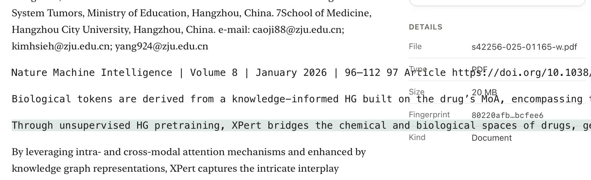
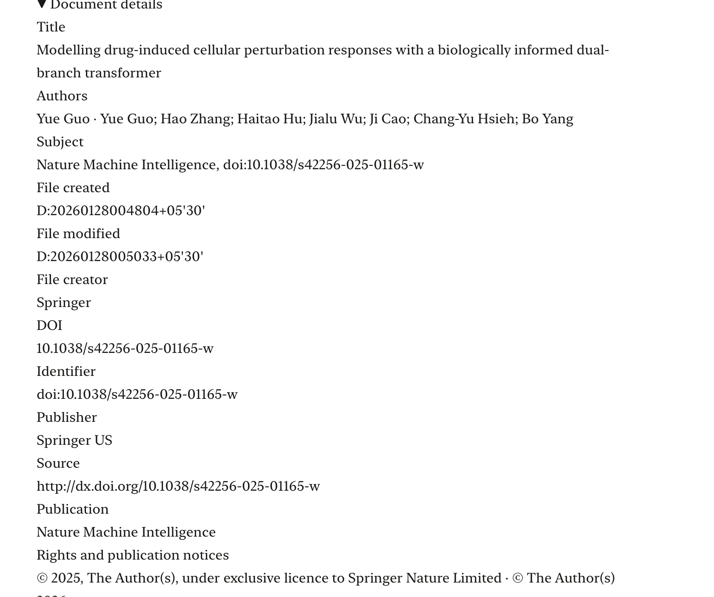
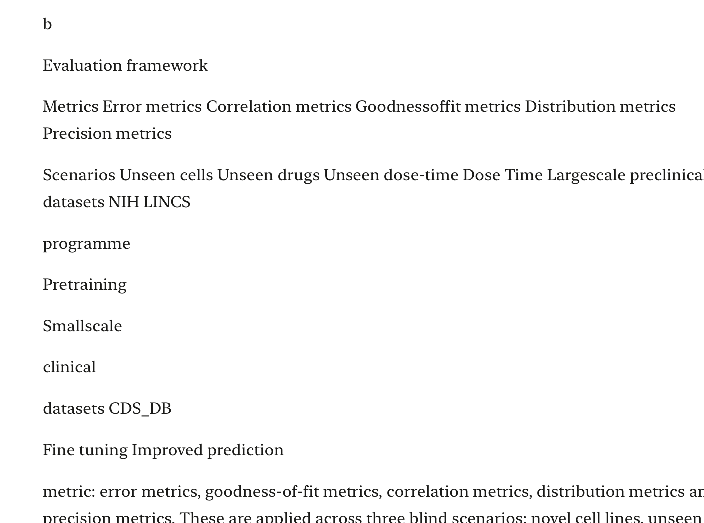
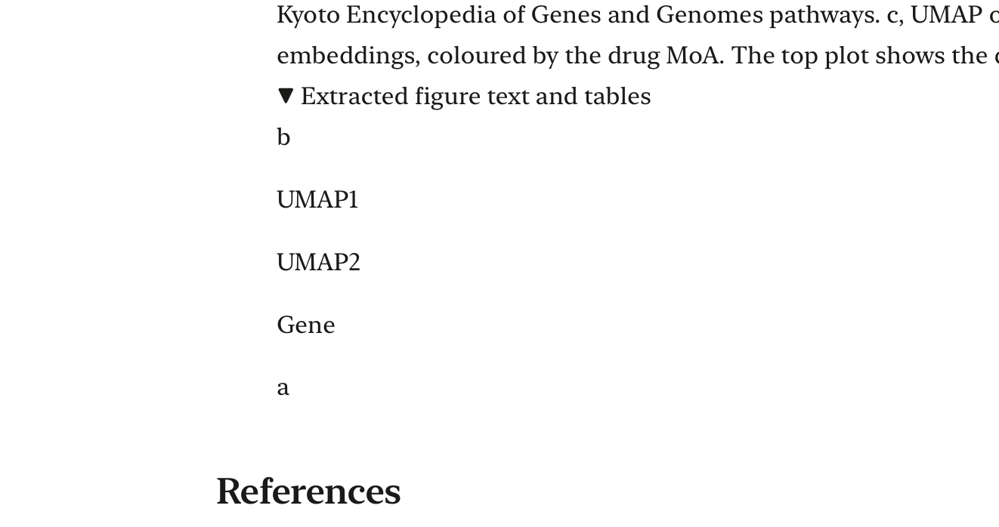
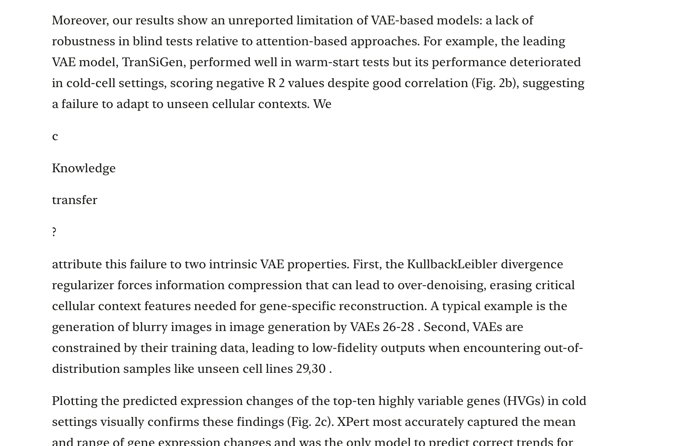

# PDF reader issues: original user screenshots

These are unchanged copies of the five screenshots supplied by the user. They
show the reported problems before the unfinished reader and extraction fixes.
They are reference material, not screenshots of a verified final implementation.

The user encountered these problems after clicking **Continue reading**. Their
goal is a human-readable document: coherent paragraphs, complete figures with
captions, readable mathematical notation, and content that fits the reading
column. Retaining raw extracted strings alone does not meet that goal.

The example document is `s42256-025-01165-w.pdf`, titled *Modelling drug-induced
cellular perturbation responses with a biologically informed dual-branch
transformer* (DOI: `10.1038/s42256-025-01165-w`). Use this document as a regression
example; follow the repository's `AGENTS.md` and build general fixes.

| Screenshot | What to inspect |
| --- | --- |
| [01: Text overflows into sidebar](01-text-overflows-into-sidebar.png) | Long monospaced lines run across the reading column into the Details sidebar. Page furniture also appears among body text. |
| [02: Document details formatting](02-document-details-formatting.png) | Metadata occupies a large, unformatted block. An author appears twice and PDF file timestamps are displayed in their raw encoded form. |
| [03: Diagram labels rendered as prose](03-diagram-labels-rendered-as-prose.png) | Evaluation-framework labels and fragments become disconnected paragraphs instead of appearing in a complete figure. |
| [04: Fragmented figure text](04-fragmented-figure-text.png) | Panel letters and axis labels such as UMAP1 and UMAP2 appear as separate text blocks under extracted figure text. |
| [05: Chart labels interrupt a paragraph](05-chart-labels-interrupt-paragraph.png) | A sentence is split between “We” and “attribute this failure” by diagram fragments including “Knowledge”, “transfer” and “?”. Mathematical notation is also flattened. |

The user additionally reported missing figures/content and badly displayed
formulas. These reports require comparison with the original PDF; the screenshots
alone cannot establish extraction completeness.

## Handoff state

The repository contains unfinished, uncommitted extraction and reader changes.
Review the current diff and test results before continuing. These screenshots
document the original failures and do not prove that those changes solve them.

On this workspace, `/tmp/gunther-reader-fix/` also contains a downloaded copy of
the public PDF, parser output, page images and audit scripts. Cached audit results
predate the latest edits and need regeneration. That temporary directory is not
included in this screenshot folder or in Git.

## Screenshot previews

### 01: Text overflows into sidebar

### 02: Document details formatting

### 03: Diagram labels rendered as prose

### 04: Fragmented figure text

### 05: Chart labels interrupt a paragraph

